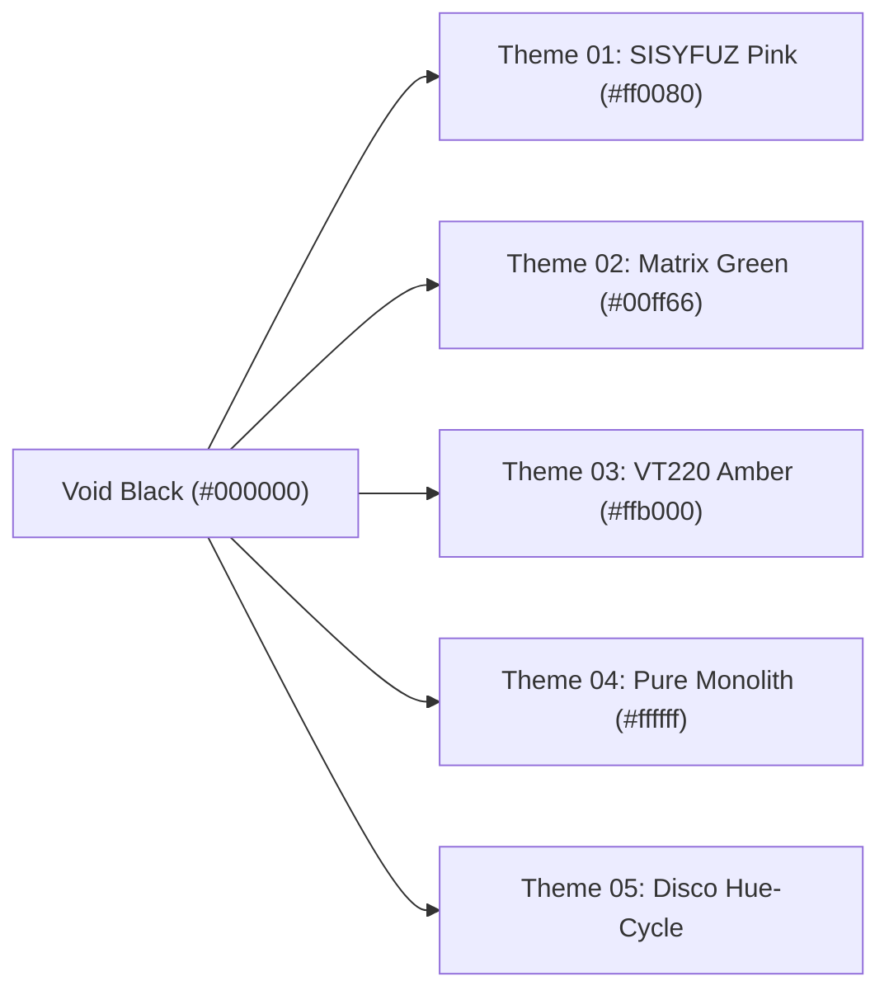

# SISYFUZ // Cyber-Brutalist & ASCII TUI Design System Specification
**Version**: 1.0.0  
**Author**: Dorus Kleijne ([sisyfuz.com](https://sisyfuz.com))  
**License**: MIT / Artistic Freedom  

---

## 1. Design Philosophy

The **SISYFUZ** aesthetic is born from the intersection of **Dutch experimental theatre**, **VT220 terminal user interfaces (TUI)**, and **cyber-brutalist functionalism**. 

Unlike modern "soft" UI that relies on blur, pastel drops, and bloated animations, SISYFUZ treats the user interface as an **active instrument** or **scientific dossier**:
1. **Structural Monospace Rigor**: Typography is not merely body copy; it forms the scaffolding, framing, and data grid.
2. **Instant State Snapping**: Zero easing or delayed transition curves. Button hovers invert instantly in reverse-video (`#ffffff` background on `#000000` text).
3. **High-Contrast Void Backdrop**: The canvas is absolute void black (`#000000`) and deep graphite (`#050505`), punctuated by radioactive neon accents (`#ff0080` hot pink, `#00ff66` matrix green, `#ffb000` amber).
4. **Ascii Structural Ornamentation**: Frames, dividers, tables, and media are rendered using monospaced ASCII glyphs (`+---`, `|`, `[ ]`, `@%#*+=-:. `).

---

## 2. The 7 Inviolate Rules of SISYFUZ Design

When applying this art style to other projects, adhere strictly to these principles:

1. **RULE 1: ABSOLUTE ZERO BORDER-RADIUS**  
   Every element must have `border-radius: 0px !important;`. No rounded buttons, no pill badges, no curved cards, no rounded modals.
2. **RULE 2: ALL CONTROLS IN ASCII SQUARE BRACKETS**  
   Interactive buttons, status pills, and keyboard shortcuts must be enclosed in ASCII brackets: `[ START ]`, `[ CANCEL ]`, `[ ⌘K ]`, `[● LIVE]`.
3. **RULE 3: REVERSE-VIDEO HOVER STATES**  
   Default buttons are transparent with a 1px border. On mouse hover, the element immediately flips to solid white background and pure black text (`hover:bg-white hover:text-black`), with zero transition delay (`transition: none`).
4. **RULE 4: STRICT MONOSPACE HIERARCHY**  
   All telemetry, timestamps, tables, metadata, and controls must use `Space Mono` or system monospaced fonts (`Menlo`, `Courier New`).
5. **RULE 5: 1PX ARCHITECTURAL DIVIDERS**  
   Separators and container borders are strictly `1px solid #262626` (dim) or `#333333` (medium). Never use heavy dropshadows or 3D skeuomorphic bevels.
6. **RULE 6: COLOR IS RESERVED FOR STATUS & TELEMETRY**  
   90% of the UI is monochrome (`#050505`, `#262626`, `#aaaaaa`, `#ffffff`). Saturated color is exclusively deployed for system status:
   - **`#ff0080` (Neon Pink)**: Live stream, active broadcast, primary accent.
   - **`#00ff66` (Neon Green)**: Success, nominal pipeline, online state.
   - **`#ffb000` (VT220 Amber)**: Warning, high load, rate limits.
   - **`#ff0055` (Crimson)**: Error, stream disconnect, destructive actions.
   - **`#00e5ff` (Cyan)**: Info, telemetry, network link.
7. **RULE 7: SOUND AS PHYSICAL FEEDBACK**  
   Auditory feedback must be short, clean, mathematically synthesized retro chirps (e.g. 80ms sine frequency sweep from 880 Hz to 587 Hz) rather than skeuomorphic UI clicks.

---

## 3. Design Tokens & Color Palettes

### 3.1 Base Monochromatic Palette

| Token | CSS Variable | Hex | Description |
| :--- | :--- | :--- | :--- |
| `void-black` | `--tui-black` | `#000000` | True black background |
| `surface-0` | `--tui-surface-0` | `#050505` | Floating windows, primary panels |
| `surface-1` | `--tui-surface-1` | `#0a0a0a` | Raised decks, secondary headers |
| `surface-2` | `--tui-surface-2` | `#141414` | Hover states, data rows |
| `border-dim` | `--tui-border-dim` | `#262626` | 1px frame borders |
| `border-med` | `--tui-border-med` | `#333333` | Button borders, modal lines |
| `border-bright` | `--tui-border-bright` | `#444444` | Focused elements |
| `white` | `--tui-white` | `#ffffff` | High contrast headings & hover fills |
| `text-bright` | `--tui-text-bright` | `#f0f0f0` | High-readability body text |
| `text-med` | `--tui-text-med` | `#aaaaaa` | Secondary labels & descriptions |
| `text-dim` | `--tui-text-dim` | `#666666` | Low-priority metadata & tags |

### 3.2 Terminal Theme Accents



- **Theme 01: `SISYFUZ_PINK` (`#ff0080`)**: Signature theater & broadcast accent. Deep dark plum surface (`#2a0014`) for alert states.
- **Theme 02: `MATRIX_GREEN` (`#00ff66`)**: Phosphor CRT terminal style with `#030d05` backdrop.
- **Theme 03: `VT220_AMBER` (`#ffb000`)**: DEC terminal amber phosphor with `#0d0700` backdrop.
- **Theme 04: `PURE_MONOLITH` (`#ffffff`)**: 100% grayscale high-contrast minimalism.
- **Theme 05: `DISCO_CYCLE`**: Dynamic `@keyframes` rotating CSS `filter: hue-rotate(0deg -> 360deg)` over 2-3 seconds.

---

## 4. Typography Specification

### Primary Monospace Font
- **Family**: `"Space Mono", "Courier New", "Menlo", monospace`
- **Aspect Ratio Compensation**: Monospace fonts have a character width-to-height ratio of **`~0.52`**. When generating ASCII matrices or canvas text, multiply character rows by `0.52` to prevent vertical distortion.
- **Font Sizes**:
  - `9px` (`--tui-font-size-2xs`): Telemetry indices, table IDs, shortcuts.
  - `10px` (`--tui-font-size-xs`): Buttons, badges, status meters.
  - `11px` (`--tui-font-size-sm`): Default reading size, chat logs, form inputs.
  - `12px` (`--tui-font-size-base`): Main headings, dossier titles.
  - `14px - 18px` (`--tui-font-size-lg`): Large ASCII title headers.
- **Casing**:
  - **ALL-CAPS**: Buttons, table headers, system labels, command prompts, status indicators.
  - **Sentence Case**: Descriptions, articles, legal text.

---

## 5. ASCII Graphics & Shaders

### 5.1 Luminance Character Ramps
To convert raster graphics or canvas video frames into raw ASCII characters:
```javascript
// 10-step standard ramp (darkest to lightest luminance)
const ASCII_RAMP = "@%#*+=-:. ";

// Convert RGB luminance (0-255) to character:
function getAsciiChar(r, g, b) {
    const lum = 0.299 * r + 0.587 * g + 0.114 * b;
    const index = Math.floor((lum / 255) * (ASCII_RAMP.length - 1));
    return ASCII_RAMP[index];
}
```

### 5.2 ASCII Box Framing Function
```javascript
export function makeAsciiBox(title = "", contentLines = [], width = 50) {
    const titleTag = title ? `[ ${title} ]` : "";
    const topDashes = Math.max(0, width - titleTag.length - 3);
    const top = `+--${titleTag}${"-".repeat(topDashes)}+`;
    const bottom = `+${"-".repeat(width)}+`;
    
    const rows = contentLines.map(line => {
        const str = String(line);
        if (str.length > width - 2) return `| ${str.slice(0, width - 5)}... |`;
        return `| ${str.padEnd(width - 2)} |`;
    });
    
    return [top, ...rows, bottom].join("\n");
}
```

---

## 6. Web Audio API Synth Sound Design

To provide tactile auditory feedback without loading heavy WAV/MP3 files:

```javascript
// Dual-tone non-intrusive retro sine chirp
export function playRetroChime() {
    const ctx = new (window.AudioContext || window.webkitAudioContext)();
    if (ctx.state === "suspended") ctx.resume();
    
    const now = ctx.currentTime;
    const osc = ctx.createOscillator();
    const gain = ctx.createGain();
    
    osc.type = "sine";
    osc.frequency.setValueAtTime(880, now); // A5 note
    osc.frequency.exponentialRampToValueAtTime(587.33, now + 0.08); // D5 note
    
    gain.gain.setValueAtTime(0.001, now);
    gain.gain.linearRampToValueAtTime(0.12, now + 0.01);
    gain.gain.exponentialRampToValueAtTime(0.001, now + 0.08);
    
    osc.connect(gain);
    gain.connect(ctx.destination);
    
    osc.start(now);
    osc.stop(now + 0.085);
}
```

---

## 7. How to Use in Other Projects

### A. Vanilla HTML & CSS
1. Copy [`sisyfuz-design-tokens.css`](file:///Users/dorusk/RiderProjects/sisyfuz.com/design/sisyfuz-design-tokens.css) into your project.
2. Link in your `<head>`:
   ```html
   <link rel="stylesheet" href="sisyfuz-design-tokens.css">
   ```
3. Use classes `.tui-btn`, `.tui-box`, `.tui-badge`, `.tui-input`, `.tui-table`.
4. Switch themes dynamically by setting attribute:
   ```javascript
   document.documentElement.setAttribute('data-theme', 'pink'); // or 'green', 'amber', 'mono'
   ```

### B. Tailwind CSS (React, Next.js, Vite, Vue, Svelte)
1. Copy [`tailwind.preset.js`](file:///Users/dorusk/RiderProjects/sisyfuz.com/design/tailwind.preset.js) into your project.
2. In your `tailwind.config.js`:
   ```javascript
   module.exports = {
       presets: [require('./design/tailwind.preset.js')],
       content: ['./src/**/*.{html,js,jsx,ts,tsx}'],
   };
   ```
3. Use Tailwind classes like `bg-tui-black`, `text-tui-pink`, `border-tui-border-dim`, `font-mono`.

### C. Figma & Token Studio
1. Import [`tokens.json`](file:///Users/dorusk/RiderProjects/sisyfuz.com/design/tokens.json) into the **Tokens Studio for Figma** plugin or **Penpot**.
2. All color tokens, typography scales, and spacing tiers will automatically generate in your design document.

### D. Living Interactive Styleguide
To see and interact with all components live in your browser:
```bash
open design/styleguide.html
```
